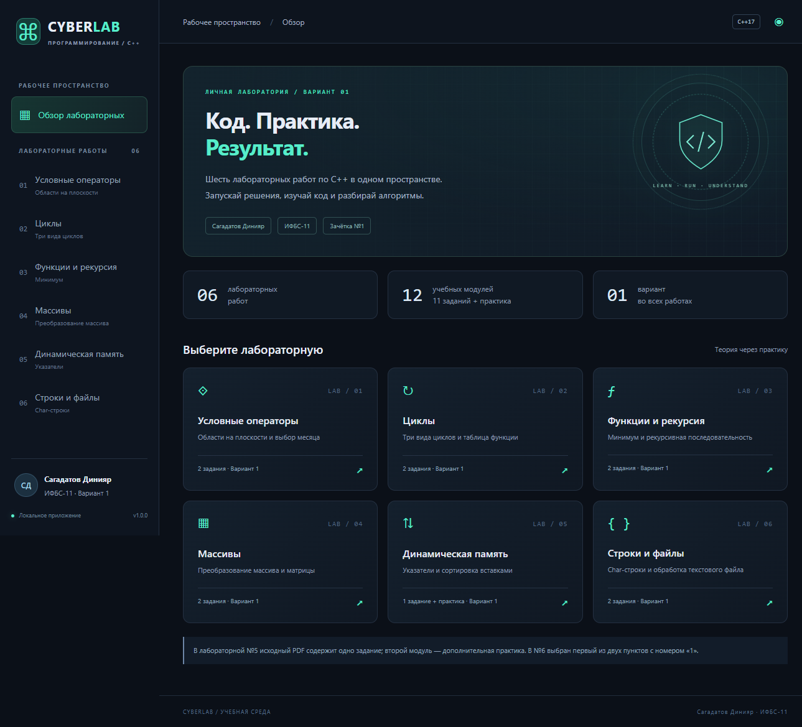

# CyberLab

Графическое Windows-приложение для лабораторных работ по C++.

**Автор: Сагадатов Динияр · Группа: ИФБС-11 · Вариант: 1**



## Запуск

Скачайте `CyberLab.exe` из раздела **Releases** и откройте двойным щелчком. Установка приложения, Python и компилятор не нужны. Требуются Windows 10/11 x64 и [Microsoft Edge WebView2 Runtime](https://developer.microsoft.com/microsoft-edge/webview2/). На компьютере, где подготовлен релиз, Runtime уже установлен.

Интерфейс, условия, исходники и пояснения встроены в EXE. Для работы с заданиями интернет не нужен. Настройки движка хранятся в `%LOCALAPPDATA%\CyberLab\WebView2`.

1. Выберите лабораторную и задание.
2. Измените входные данные или оставьте пример, нажмите **Выполнить**.
3. Ниже находятся полный самостоятельный C++-код без комментариев и разбор по блокам. Код можно скопировать.
4. В работе 6.2 откройте UTF-8 файл или введите текст, выполните обработку и сохраните выбранные строки в **новый** файл. Существующие файлы защищены от перезаписи.
5. Кнопка в правом верхнем углу отключает анимации. Интерфейс также учитывает системное предпочтение уменьшенного движения.

## Соответствие материалам

Номера работ взяты из суффиксов `(01)`–`(06)` предоставленных PDF, везде выбран первый пункт.

| Работа | Задание 1 | Задание 2 |
|---|---|---|
| 1. Условные операторы | Точка в верхнем полукруге радиуса 3 | Название месяца |
| 2. Циклы | Нечётные 1…21: while, do while, for | Таблица кусочной функции |
| 3. Функции и рекурсия | minimal и заданное выражение | Рекурсивная последовательность |
| 4. Массивы | Замена положительных элементов | Среднее нечётных над главной диагональю |
| 5. Динамическая память | Случайный массив и сортировка вставками | **Дополнительная** пошаговая практика |
| 6. Строки | Вставка в нуль-терминированную char-строку | Отбор строк по пробелу и подстроке |

**В PDF №5 только одно задание.** Второй модуль добавлен для практики и явно помечен в интерфейсе. **В PDF №6 два пункта с номером «1».** Выбран первый по порядку: строки с пробелом и сохранение строк с подстрокой. Дополнения не выдаются за задания из методички.

Функция работы 2.2: `x*x + 0.2` при `x < 0`; `0.2*x + 0.1` при `0 <= x < 0.9`; `1 / ((0.1+x)*(0.1+x))` при `x >= 0.9`.

## Проверка данных

- Числа полностью проверяются в C++, включая лишние символы, NaN, бесконечность и диапазоны. Вещественные числа принимаются с точкой или запятой; целые — только обычной десятичной записью.
- Таблица: максимум 1000 строк; положительный шаг от 0,000001; начало не больше конца. Конец включается, если попал на сетку шага. Сравнения около 0 и 0,9 учитывают погрешность double.
- Координаты и числа в выражениях: ±1 000 000. Для геометрической границы используется допуск 10⁻¹⁰ по y и квадрату радиуса.
- Рекурсия: n = 1…24, точные вычисления в `long long`, без экспоненциального повторного пересчёта.
- Массив: 1…200 элементов; матрица: 1…20 строк, строго квадратная; пошаговая сортировка: до 30 элементов.
- Пустая выборка нечётных элементов не делится на ноль.
- Каждая char-строка: до 2048 байт UTF-8; буфер результата: 4097 байт. Индекс начинается с нуля и считается по Unicode-кодовым точкам, не по графемам. Например, составной эмодзи может занимать несколько позиций.
- Файл: до 256 КиБ, UTF-8 (с BOM или без), без NUL. Сохраняется UTF-8 без BOM, строки разделяются LF. Поиск учитывает регистр; подстрока не может быть пустой. Обычный пробел и табуляция различаются.

Это ограниченные и проверенные области допустимого ввода, а не обещание отсутствия любых возможных ошибок.

## Исходники

Учебные алгоритмы используют только стандартную библиотеку C++17. Графическая оболочка — Win32 + WebView2 и обычные HTML/CSS/JavaScript без фронтенд-фреймворков. Код решения, который отображается в окне, собирается из тех же функций, которые выполняет EXE.

| Путь | Назначение |
|---|---|
| `labs/lab11.cpp` … `labs/lab62.cpp` | Короткие функции решения |
| `labs/common.hpp` | Общая компактная проверка ввода |
| `standalone/` | 12 самостоятельных программ с `main`, без комментариев |
| `src/main.cpp` | Окно, вызов алгоритмов, диалоги и буфер обмена |
| `ui/` | Оформление, навигация, условия и объяснения |
| `prepare.py` | Сборка самостоятельных исходников и встраивание интерфейса |
| `tests/` | Проверки алгоритмов и графического приложения |

Не редактируйте `standalone/` вручную: после правок в `labs/` запустите `python prepare.py`.

## Сборка и тесты

Для разработки: Visual Studio 2022/2026 Build Tools с компонентом **Desktop development with C++**, Python 3.10+ и PowerShell. Для первой сборки нужен интернет: скрипт скачает официальный WebView2 SDK из NuGet. Сам Python использует только стандартную библиотеку.

```powershell
.\test.ps1
.\build.ps1
.\build\CyberLab.exe
```

При нестандартном пути к Python: `./build.ps1 -Python 'C:\путь\python.exe'`.

`test.ps1` компилирует все 12 самостоятельных решений и выполняет 201 проверку: 187 сценариев для алгоритмов, границ, неправильного ввода и случайных массивов, плюс 14 проверок файлов. Отдельная проверка `tests/ui.cjs` проверяет реальные вызовы C++ через окно приложения; для неё нужен Node.js с Playwright и локальный отладочный порт WebView2 9333 (или адрес из переменной `CYBERLAB_CDP`). В обычном запуске приложение этот порт не открывает.

Самостоятельные программы читают поля в порядке, показанном в интерфейсе, каждое поле с новой строки. В 4.2 после n идут n строк матрицы. В 6.1 после двух строк идут режим (0 — начало, 1 — конец, 2 — позиция) и позиция. В 6.2 вводятся **путь исходного файла, путь нового файла и подстрока**, по одной строке. Для русских путей используйте графическое приложение; самостоятельный пример 6.2 использует стандартные узкие файловые пути C++. Терминалу для русских сообщений нужна UTF-8.

## Выпуск версий

GitHub Actions проверяет и собирает изменения в `main`. Для нового релиза обновите номера в `ui/index.html` и `src/app.rc`, затем:

```powershell
git add .
git commit -m "Release 1.0.1"
git tag v1.0.1
git push origin main --tags
```

Публикация тега `v*` автоматически создаёт GitHub Release с EXE, архивом исходников и SHA-256. Закрытые ключи и токены в проект не включены. Готовый EXE не содержит консольного окна и использует статическую библиотеку времени выполнения MSVC.
